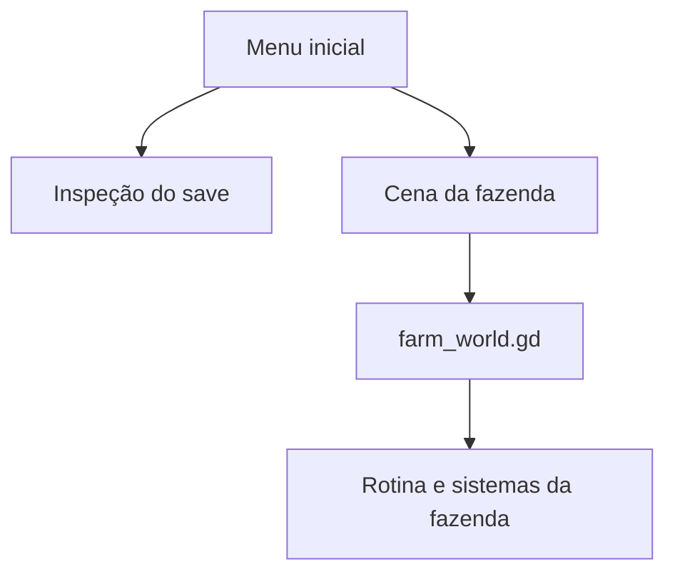

# Arquitetura da simulação em Godot

[project.godot](../godot/project.godot) carrega o [menu inicial](../godot/scenes/main_menu.tscn). [main_menu.gd](../godot/scripts/main_menu.gd) verifica o save principal e uma versão de recuperação, classifica formatos incompatíveis e encaminha o jogador à [cena da fazenda](../godot/scenes/farm_world.tscn).

| Área | Comece por |
| --- | --- |
| Mundo e composição | [farm_world.gd](../godot/scripts/farm_world.gd) |
| Vida rural e ciclo diário | [life_sim.gd](../godot/scripts/life_sim.gd), [rural_time.gd](../godot/scripts/rural_time.gd) e [rural_schedule.gd](../godot/scripts/rural_schedule.gd) |
| Trabalho na fazenda | [farming_system.gd](../godot/scripts/farming_system.gd) e [farm_missions.gd](../godot/scripts/farm_missions.gd) |
| Entrada e movimento | [farmer_controller.gd](../godot/scripts/farmer_controller.gd) |
| Persistência local | [save_store.gd](../godot/scripts/save_store.gd) |

A interface de início usa o esquema de save versão 1. Valida valores finitos de posição e recursos e examina o arquivo de recuperação quando o principal falha. Ao acrescentar um campo persistido, acompanhe a escrita e a restauração e verifique como um save anterior, sem esse campo, entra no mundo.

Os módulos Python em [gameplay](../gameplay) modelam partes da rotina para testes independentes. Os passos de QA para a cena e a distribuição estão no [plano de testes da rotina](LIFE_SIM_TEST_PLAN.md) e no [checklist de Windows](CHECKLIST_RELEASE_WINDOWS.md).
